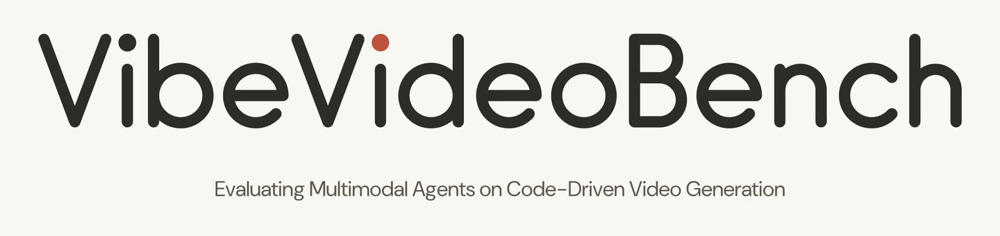
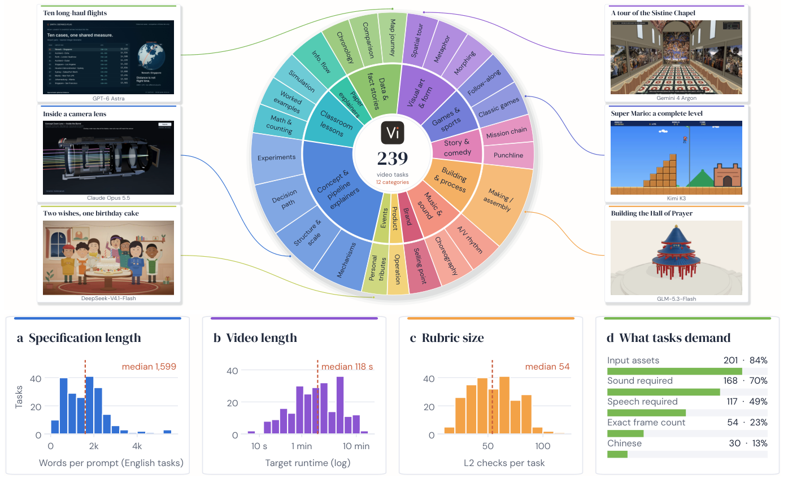

# [VibeVideoBench: Evaluating Multimodal Agents on Code-Driven Video Generation](https://arxiv.org/abs/2610.35864)

[](https://arxiv.org/abs/2610.35864)
[](https://vibevideobench.github.io)


[](LICENSE)

<p align="center">
    <a href="https://vibevideobench.github.io"></a> <br>
</p>

## 💥 News 💥

**[2026.10.30]** 📊 We have open-sourced the [dataset](https://huggingface.co/datasets/diaomuxi/vibevideobench) and the evaluation rubric on Hugging Face, along with the [evaluation code](#quick-start). 🚀

**[2026.10.27]** 📄 Our paper is now available on [arXiv](https://arxiv.org/pdf/2610.35864). 🚀

**[2026.10.26]** 🌐 Our project homepage is live at [vibevideobench.github.io](https://vibevideobench.github.io/). 🚀

## 👀 About VibeVideoBench

A benchmark for agents that make finished videos. Each task is a production brief with source material; an AI coding
agent works in an isolated Linux sandbox for up to one hour and must deliver an MP4 (plus the editable project behind
it). The video is then checked by program checks and graded by AI judges against a task-specific rubric.

- **239 tasks** — 209 in English, 30 in Chinese, including 34 education tasks (videos that explain a paper or a
  lesson); the tasks, rubrics and quizzes are a separate dataset on HuggingFace (`diaomuxi/vibevideobench`)
- **12,985 binary rubric checks** — each a pass / fail / unknown question a reviewer can answer from the finished video
- **5 quality dimensions** scored 1–5 with task-specific anchors: image quality, visual design, clarity, timing, audio
- **L1 program checks** on the file itself (decode, size, frame rate, duration, audio, speech, language ...)
- **404 grounded quiz questions** for the education tasks: does the video teach what the source says?

<p align="center">
     <br>
    <em>Benchmark composition (239 tasks): 12 categories and their presentation forms, with real deliveries from six model families (top); specification length, video length, rubric size and task requirements (bottom).</em>
</p>

Agents run through their vendors' own agent CLIs (Codex CLI, Claude Code, Antigravity CLI, ...) against the official
APIs. Provider keys stay on the host: the sandbox only gets a per-run token for a local gateway.

```
 sandbox container (vibe-l0)                  host
 ┌──────────────────────────┐   127.0.0.1    ┌─────────────────────────┐       ┌──────────────┐
 │ agent CLI (codex, ...)   │ ─────────────▶ │ gateway/model_gateway   │ ────▶ │ model API    │
 │ ffmpeg, Python, Node,    │                │   per-run token, keys,  │       └──────────────┘
 │ Chromium, fonts          │ ─────────────▶ │   deadline, request log │       ┌──────────────┐
 │ /opt/benchmark-tools/tts │                │ gateway/tts_gateway     │ ────▶ │ Qwen3-TTS    │
 └──────────────────────────┘                └─────────────────────────┘       └──────────────┘
            ▲ one fresh container per task (8 CPUs, 32 GB, 3600 s)
            │
  controller/  freeze → schedule → run_case → collect + program checks
  judge/       L1 checks → rubric judges (2 phases) → quiz → report
```

## Get the data

This repository is the evaluation pipeline only. The tasks, rubrics, tags and quizzes are the HuggingFace dataset
[`diaomuxi/vibevideobench`](https://huggingface.co/datasets/diaomuxi/vibevideobench); the pipeline reads them from `data/`:

```bash
huggingface-cli download diaomuxi/vibevideobench --repo-type dataset --local-dir data
python3 data/fetch_external.py        # 62 inputs the dataset may not redistribute, ~2 GB (two source videos)
```

The second step matters: 62 inputs of 23 tasks (arXiv papers, Adobe font documentation, press images, video excerpts, web pages, photos of
identifiable people, stock photos, brand marks) are not in the dataset and must be downloaded before you evaluate —
`data/EXTERNAL_INPUTS.md` lists each with its link and checksum. `vvbench.py doctor` reports anything missing, and
`vvbench.py run` refuses to start until everything is in place, so a run never stalls on a download.

## Quick start

You need a Linux x86_64 host with Docker, Python 3.10+ and ffmpeg. Full details: [docs/install.md](docs/install.md).

```bash
# 1. build the sandbox image (downloads Node, Chromium, fonts and wheels; checksums are verified)
cd docker && ./fetch.sh && ./build.sh && ./sandbox.sh smoke && cd ..

# 2. judge dependencies
pip install -r judge/requirements.txt

# 3. the data (see "Get the data" above): the dataset into data/, then the inputs it may not redistribute
huggingface-cli download diaomuxi/vibevideobench --repo-type dataset --local-dir data
python3 vvbench.py fetch-data

# 4. create your local config files from the examples
python3 vvbench.py init
#    keys.env                API keys (see below)
#    controller/config.json  where you installed each agent CLI (docs/harnesses.md)
#    systems.json            the systems to evaluate (the nine of the paper are predefined)

# 5. check, then run: every task on every chosen system, then all judges and the report
python3 vvbench.py doctor --systems claude_opus
python3 vvbench.py run exp1 --systems claude_opus
```

`exp1` is the experiment directory; it is created on first use, and all runs, judgments and the report go into it.
When the run finishes, the scores are in `exp1/report/summary.md` (with `summary.json` and `per_task.csv` next to
it; see [Scoring](#scoring)). To try a few tasks first:
`python3 vvbench.py run trial --systems claude_opus --tasks D0130,W0042,PA01`.

To keep keys and local paths out of the checkout, put the four config files (`keys.env`, `systems.json`,
`controller.json`, `judge.json`) in a directory of your own and pass it: `python3 vvbench.py --config-dir ~/vvb-config init`,
then the same `--config-dir` (or `export VVBENCH_CONFIG_DIR=~/vvb-config`) for every command.

`run` is restartable: after an interruption, run the same command again and it continues. Finished runs (they have a
`terminal.json`) and finished judgments are never redone. `python3 vvbench.py judge exp1` re-judges only what is
missing (for example after a judge API error), and `python3 vvbench.py report exp1` rebuilds the report.

## What you need

**API keys** in `keys.env` (one `NAME=value` per line; the file is gitignored):

| key | used for |
|---|---|
| the evaluated system's key (`ANTHROPIC_API_KEY`, `OPENAI_API_KEY`, `GEMINI_API_KEY`, `DEEPSEEK_API_KEY`, `MOONSHOT_API_KEY`, `ZAI_API_KEY`) | the agent |
| `DASHSCOPE_API_KEY` | the text-to-speech tool agents use for narration (Qwen3-TTS), and the omni judge |
| `GEMINI_API_KEY`, `OPENAI_API_KEY` | the rubric judges and the quiz (always needed for judging) |

DashScope keys belong to one region. The TTS gateway calls the mainland China endpoint and the omni judge
(`judge/config.json`) the international one: with an international key, also set
`DASHSCOPE_TTS_URL=https://dashscope-intl.aliyuncs.com/api/v1/services/aigc/multimodal-generation/generation` in
`keys.env`; with a mainland key, change the `qwen` base_url in `judge/config.json` to
`https://dashscope.aliyuncs.com/compatible-mode/v1`.

A system can list several keys (`key_vars`); a key that runs out of credit is set aside and the next one is used.
When all keys of a system are out of credit, no new runs of that system start.

**Agent CLIs.** They are not shipped; install the ones you evaluate on the host and put their directories in
`controller/config.json`. [docs/harnesses.md](docs/harnesses.md) lists, for each CLI, where to get it, the version
the benchmark was run with, and how it is configured inside the sandbox.

**Compute.** Each run gets 8 CPUs, 32 GB of memory and 3600 s of wall-clock time; time lost to failed API requests is
added back (up to 30 min). `--per-system N` (default 4) sets how many runs of one system go in parallel, so plan
`8 × N` CPUs per system. A full run is 239 hours of agent time per system.

## Systems

`systems.example.json` defines the nine systems of the paper, each with the vendor's agent CLI and official API:

| system | agent CLI | model | effort |
|---|---|---|---|
| `gemini4_argon` | Antigravity CLI | `gemini-4-argon` | high |
| `gemini38_flash` | Antigravity CLI | `gemini-3.8-flash` | high |
| `gpt56_sol` | Codex CLI | `gpt-5.6-sol` | max |
| `gpt6_astra` | Codex CLI (0.162.1) | `gpt-6-astra` | max |
| `claude_opus` | Claude Code | `claude-opus-5-5` | max |
| `claude_sonnet` | Claude Code | `claude-sonnet-5-5` | max |
| `deepseek_dsh` | DeepSeek Harness | `deepseek-flash` (V4.1-Flash-1017) | max |
| `kimi_k3` | Kimi Code | `kimi-k3` | max |
| `glm53_flash` | ZCode CLI | `glm-5.3-flash` | max |

To evaluate another model, add an entry with its harness, model id, effort, upstream base URL and key variable; the
field reference is the `_comment` at the top of the file.

## Scoring

Every run is judged on its delivered MP4 only. The rubric judges never learn which system made a video.

- **L1** (`judge/l1_judge.py`): program checks from each task's rubric, measured with ffprobe, full decoding, voice
  activity detection and Whisper language ID; items that need judgment go to a text model with the measured facts.
- **Rubric, phase 1** (`judge/judge_v4.py`): two full-modality judges (`gemini-4-argon`, `gemini-3.8-flash`) each
  watch and listen to the whole video and answer every rubric check (pass / fail / unknown, with timestamps) and score
  the five quality dimensions. A run without a video gets a short text pre-check of its final messages.
- **Rubric, phase 2** (`judge/judge_v4_p2.py`): an omni judge group that splits the checks by modality tag — visual
  checks to `gpt-5.6-sol`, audio checks to `qwen3.8-omni-flash` — and is merged into one result.
- **Quiz** (`judge/quiz_judge.py`): for the 34 education tasks, a judge answers multiple-choice questions about the
  source material from the video alone, quoting the timestamp; an answer whose evidence does not check out counts as
  wrong.

`judge/report.py` combines them. Each metric is computed per judge group (the two phase-1 judges and the phase-2
group) and then averaged over the three:

| metric | definition |
|---|---|
| deliver | runs that delivered an MP4 / tasks |
| playable | runs with an MP4 that the judges could score / tasks |
| score0 | per quality dimension the mean 1–5 score, a run without a scorable video counted as 0; then the mean of the five dimensions (systems are ranked by it) |
| score | the same over scored videos only |
| rate | rubric check pass rate: pass / (pass + fail) over all checks of the scored videos |
| strict | share of runs with no failed core check and at least one passed check (no video = not passed) |
| l1_rate | L1 pass / (pass + fail) over runs with a video |
| quiz | mean quiz score over the education tasks (no video = 0) |

Each is reported for all tasks and separately for the main (205) and education (34) sets. `summary.json` has the
per-judge figures and `per_task.csv` one row per run.

## Repository

```
vvbench.py            one entry point: init, fetch-data, doctor, run, judge, report
docker/               sandbox image: Dockerfile, pinned package lists, download script with checksums, smoke test
gateway/              model gateway (per-run tokens, key rotation, request log) and the TTS gateway
controller/           freeze.py (task snapshot), schedule.py, run_case.py (one container per run),
                      collect.py + check_delivery.py (picks the video, program checks), guide_sandbox.md (agent guide)
judge/                l1_judge.py, judge_v4.py, judge_v4_p2.py, quiz_judge.py, report.py
data/                 not in this repository: the HuggingFace dataset is downloaded here (see Get the data)
docs/                 install.md (setup in detail), harnesses.md (agent CLIs)
systems.example.json  the nine evaluated systems      keys.env.example  key names
```

Each experiment directory holds everything it produced: `snapshot/` (the frozen tasks), `runs/<system>/<task>/`
(workspace, collected video, every API request and response, `terminal.json`), `logs/`, the judge results and
`report/`.

## Citation

```bibtex
@misc{diao2026vibevideobenchevaluatingmultimodalagents,
      title={VibeVideoBench: Evaluating Multimodal Agents on Code-Driven Video Generation},
      author={Muxi Diao and Wenbin Xu and Lele Yang and Xuyang Ma and Yuzhe Chen and Jiankang Chen and Kaiyu Jiang and Changyi Liu and Haoyu Zhang and Hongyi Fu and Jianxiong Wang and Tianke Zhang and Haonan Fan and Yingxin Li and Bingyi Li and Xu Wang and Xuanyu Zheng and Bin Wen and Tingting Gao and Han Li and Wentao Zhang and Weiran Xu and Kongming Liang and Zhanyu Ma},
      year={2026},
      eprint={2610.35864},
      archivePrefix={arXiv},
      primaryClass={cs.CV},
      url={https://arxiv.org/abs/2610.35864},
}
```

## License

The code in this repository is licensed under the [Apache License 2.0](LICENSE). The dataset is published separately
on HuggingFace under CC BY-NC-SA 4.0, except for third-party task inputs that keep their own licenses (listed in the
dataset's `NOTICE.md`).
